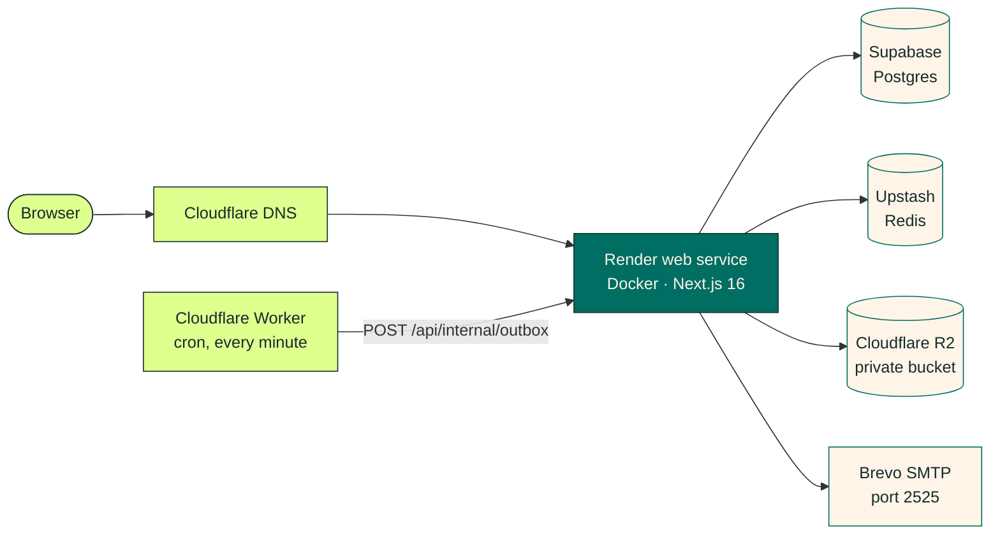

<picture>
  <source media="(prefers-color-scheme: dark)" srcset="docs/readme/banner-dark.png" />
  <source media="(prefers-color-scheme: light)" srcset="docs/readme/banner.png" />
  
</picture>

<p align="center">
  <a href="LICENSE"></a>
  <a href="https://nextjs.org"></a>
  <a href="docs/DEVELOPMENT.md"></a>
  <a href="docs/DEPLOYMENT_CLOUD.md"></a>
</p>

<p align="center">
  <a href="#host-it-on-a-vps-with-docker">Host on a VPS</a> ·
  <a href="#run-it-for-free">Free cloud hosting</a> ·
  <a href="#quick-start-local">Quick start</a> ·
  <a href="docs/README.md">Documentation</a> ·
  <a href="CONTRIBUTING.md">Contributing</a> ·
  <a href="#credits">Credits</a>
</p>

**Space Works Events is a free, open-source event platform from Space Works for maker and community
events.** Publish an event page, take registrations, send live QR tickets, check people in at the door,
print ID cards, run a member programme and follow up with feedback and certificates, all from one
self-hosted app you control. Events are free by default; when you charge, tickets are paid straight to
your own Razorpay or Stripe account with no platform fee. No ads, no third-party trackers, and your
guests' data stays in your own database. It's built on
[Yuyu](https://github.com/twilighty-abhi/yuyu) by Abhiram N J (see [Credits](#credits)).

## What you can do

Grouped the way an organiser's week actually goes.

### Plan and publish

- Event pages in your colours: a cover photo editor, programme tracks, speakers, venues, sponsors, FAQs and resources.
- Public, hidden-link, invite-only or approval-required events, with an option to list them on Discover.
- **Short links** like `/aB3x9Kq` for every event, easy to share and to say out loud.
- Recurring series, organisation roles and event co-organisers.

### Register

- Custom registration forms with ten question types, help text and "show only if" logic.
- Capacity limits, waitlists and approvals, with undo when you remove someone by mistake.
- Confirmation emails with a calendar invite, sent through a durable outbox.

### Sell tickets (optional)

- **Your own Razorpay or Stripe account**: buyers pay on the provider's page and the money goes straight to you, with no platform fee.
- Ticket types with fixed or pay-what-you-want prices, group tickets, extras, promo codes, access codes, members-only tickets and series passes.
- Refund policies, refunds and transfers, pay-at-the-desk, PDF receipts, chargeback alerts, and money reports with an orders CSV. See [Paid tickets](docs/PAYMENTS.md).

### Tickets and the door

- **Live tickets**: a private QR ticket that tears off its stub on the guest's phone the moment they're checked in.
- A check-in desk for QR, search and manual check-in, with undo.
- **Offline check-in**: download the roster and keep scanning when the venue Wi-Fi drops; it syncs when you're back.
- PIN-locked door stations, so volunteers can check people in without an account.

### ID cards and badges

- **Colour ID cards and badges** with your organisation logo, the guest's check-in QR and the registration answers you choose.
- A badge designer with stock sizes (A6, 4 × 6 in, CR80 and more), drag-and-drop layout, undo and test prints.
- Print one badge at check-in, or download every badge as **one print-ready PDF**.

### Member IDs

- Run a membership or community ID programme: a public join form with an optional photo, CSV or Google Sheet import, and approvals.
- Front-and-back colour cards with photos, per-programme ID numbers and expiry dates, and bulk PDF or ZIP downloads.
- A **verify QR** on every card that shows Valid, Expired or Revoked to whoever scans it.
- Members keep their cards in a **holographic wallet** that tilts and flips, and can download them to print.

### Follow up

- **Broadcasts** to any mix of confirmed, waitlisted or checked-in guests, with 13 starter templates, five email designs, a review step and **a five-second undo**.
- Feedback forms and response reporting, with a registration funnel in event analytics.
- **Certificates** built from text and image layers on your own artwork.

### Run it safely

- Organisation staff must use an authenticator app (**MFA**), checked each session.
- Sign-in protections: failure limits, an emailed code for a new device, new-sign-in alerts, and a breached-password check.
- A separate **super admin** area, whose password is set only from the server, with instance settings and read-only insights.
- Organisation isolation, role checks, audit events, rate limits, CSP nonces and private object storage.
- A tenant-bound **machine API** with scoped, rotating credentials. See [Machine API v1](docs/API.md).
- Personal data export, light and dark modes, and accessible defaults throughout.

The full list lives in [Features](docs/FEATURES.md).

## A look around

<table>
  <tr>
    <td width="50%" valign="top">
      
      <p><strong>Home.</strong> What it is, in one screen.</p>
    </td>
    <td width="50%" valign="top">
      
      <p><strong>Event page.</strong> Your cover, your colours, one clear "Register — it's free".</p>
    </td>
  </tr>
  <tr>
    <td width="50%" valign="top">
      
      <p><strong>Organiser dashboard.</strong> The next event, sign-ups and the month ahead.</p>
    </td>
    <td width="50%" valign="top">
      
      <p><strong>Check-in desk.</strong> Scan, search, or go offline when the Wi-Fi drops.</p>
    </td>
  </tr>
  <tr>
    <td width="50%" valign="top">
      
      <p><strong>Badge designer.</strong> Colour ID cards on real badge stock.</p>
    </td>
    <td width="50%" valign="top">
      
      <p><strong>Member IDs.</strong> Approve members and issue numbered cards.</p>
    </td>
  </tr>
  <tr>
    <td width="50%" valign="top">
      
      <p><strong>ID wallet, dark mode.</strong> Tilt it, flip it, verify it.</p>
    </td>
    <td width="50%" valign="top">
      
      <p><strong>Event report.</strong> From sign-up to thank-you, with a PDF to share.</p>
    </td>
  </tr>
</table>

## Host it on a VPS with Docker

**Yes — the complete application runs on your own VPS, installed with one line.**
Like SpaceWorks, it ships as a **backend** image (the API, which also runs the
database migrations and operator tools) and a **frontend** image (the website).
The production Docker Compose stack runs them with **PostgreSQL 16**,
**Redis 7**, private **[Silo](https://github.com/pgsty/silo)** object storage (the
maintained, S3-compatible fork of the archived MinIO) for images and files,
automatic public HTTPS with Caddy, database migrations, an email worker and a
beat for timed jobs. Only a domain and an authenticated SMTP relay are external;
Render, Supabase, Upstash and Cloudflare are optional hosting choices.

### Install in one line

On a 64-bit Linux server (Ubuntu/Debian, Fedora/RHEL/Alma/Rocky, Arch or openSUSE),
as root or a user with `sudo`:

```bash
curl -fsSL https://raw.githubusercontent.com/SpaceWorks-Labs/SpaceWorks-Events/main/install.sh | bash
```

It checks the server, picks the latest [release](https://github.com/SpaceWorks-Labs/SpaceWorks-Events/releases)
and asks every question first: the layout (by default the website and API
containers both on this VPS, at `events.example.com` and `api.events.example.com`;
or one app container on one hostname; or the website on Netlify), hostnames, the
super-admin email, HTTPS (automatic Let's Encrypt, a LAN/trial certificate, or
your existing reverse proxy), file storage (bundled Silo or an external S3/R2
bucket), your SMTP relay (Brevo is prefilled on port 2525) and whether to set up
automatic deploys. Invalid answers are asked again. One summary lists every choice and host
change, and **nothing changes until you confirm it**. Then it installs Docker if
needed, generates every secret and internal TLS certificate without printing them,
downloads the release's ready-made images from
[GitHub Packages](docs/CONTAINER_IMAGES.md) (amd64 and arm64), migrates and
checks that each service is healthy. Nothing is compiled on your server.

**Before you start:** 2 vCPU, 2 GB RAM and 30 GB SSD for a small instance, DNS A
records pointing at the server (two for the default layout), inbound ports 80 and 443, an SMTP
relay on a verified sending domain, and your super-admin email.

### Update, back up and check

Run the same command again. An existing installation shows a menu:

1. **Update to the latest release** — backs up the database and configuration,
   downloads the new images while the site keeps running, migrates and restarts. If
   the new release is not healthy, the previous one is restored automatically.
2. **Back up now** — database, configuration and uploaded files, into
   `/etc/spaceworks-events/backups/`.
3. **Check status and health** — services, disk, newest backup and live checks.
4. **Backups** — nightly schedule, retention, encryption to a key you keep off the
   server (`age`), and copies to an off-site S3 bucket. Failures and stale backups
   show on Super admin → Operations and are emailed to the super admin.
5. **Change settings** — hostnames, outgoing email (SMTP) or bucket credentials;
   rolled back automatically if the checks fail.
6. **Server security** — a firewall allowing only SSH, HTTP and HTTPS, automatic
   security updates and fail2ban.
7. **Automatic deploys** — install (or remove) a GitHub Actions runner so every
   published release updates the server by itself, as in SpaceWorks.
8. **Recover super-admin access** — for a lost authenticator or password: resets
   MFA and prints a one-hour reset link.
9. **Support bundle** — checks and recent logs with secrets redacted.
10. **Uninstall** — keeps the data, secrets and backups unless you type `DELETE DATA`.

`0` (the default) cancels without changing anything.

The internal service certificates renew themselves before they expire (a weekly
systemd check), and setup asks about backups and hardening up front.

Releases live in `/opt/spaceworks-events/releases/<commit>` with `current` pointing
at the running one; secrets stay in `/etc/spaceworks-events`. Options: `--release`
for a specific release, `--ref` to build a branch or commit from source (needs
4 GB of memory), `--repo` for a fork, `--dir` for another location and `--update`
to skip the menu; `bash install.sh --help` lists them. A new release is published
by the first `main` build of each new `VERSION`. A restore is a
deliberate step: `sudo bash /opt/spaceworks-events/current/scripts/vps-restore.sh <backup>`.

The installer does not change DNS or provision SMTP. The
**[complete VPS guide](docs/DEPLOYMENT_VPS.md)** covers manual
installation from a checkout, updates, rollback, backups and restores, internal
certificate renewal and monitoring. Use `compose.production.yml`; the development
and staging Compose files are not production setups.

### Can the frontend live on Netlify and the backend on the VPS?

**Yes.** Choose mode 2 in the installer. Docker runs authentication, the API,
business actions, PostgreSQL, Redis, private file storage and jobs on your VPS.
The separate `frontend/` workspace renders the shared Next.js UI on Netlify and
calls the VPS through a private server gateway. Browser API requests use the
frontend origin; ticket live updates stream directly from the VPS.

The installer writes a separate `frontend.env` containing only the frontend's
URLs, gateway credential and its own stable Server Actions key. Add those settings
to Netlify, set **Package directory = `frontend`**, leave **Base directory at the
repository root**, and use `frontend/netlify.toml`. Deploy the same source revision
on both hosts. Follow the [Netlify + VPS guide](docs/DEPLOYMENT_SPLIT.md) for DNS,
OAuth, exact environment settings, development and verification.

The [SpaceWorks reference](https://github.com/SpaceWorks-Labs/SpaceWorks) uses a
Vite/Django split. Events preserves its Next.js server rendering and uses explicit,
authenticated backend contracts for this arrangement.

For a Docker app with managed dependencies, use the
[Docker deployment guide](docs/DEPLOYMENT_DOCKER.md). For Kubernetes, use the
[Helm chart](charts/spaceworks-events/README.md).

## Run it for free

The optional cloud production setup runs on free plans. One Docker service on Render serves the app;
everything else is a managed free tier, and a Cloudflare Worker calls the app every minute to keep the
instance awake, run the timed jobs and send the email queue.



<p>
  <a href="https://render.com/deploy?repo=https://github.com/SpaceWorks-Labs/SpaceWorks-Events">
    
  </a>
</p>

In five steps (the [free-tier cloud guide](docs/DEPLOYMENT_CLOUD.md) has every click):

1. **Database and cache.** Create a [Supabase](docs/DEPLOYMENT_CLOUD.md#1-supabase-postgresql) project and an
   [Upstash](docs/DEPLOYMENT_CLOUD.md#2-upstash-redis) Redis database in the same region.
2. **Files and email.** Create a private [Cloudflare R2](docs/DEPLOYMENT_CLOUD.md#3-cloudflare-r2-object-storage)
   bucket and a [Brevo](docs/DEPLOYMENT_CLOUD.md#4-brevo-email) SMTP key (port 2525, because Render's free plan
   blocks the usual mail ports).
3. **Secrets.** [Generate](docs/DEPLOYMENT_CLOUD.md#5-generate-secrets) the encryption keys and keep them in
   your password manager.
4. **Deploy.** Click **Deploy to Render** (or **New → Blueprint**) and fill in the prompts from
   [`render.yaml`](render.yaml). Migrations run when the container starts.
5. **Wake and send.** Point your domain at Render and deploy the
   [cron Worker](docs/DEPLOYMENT_CLOUD.md#8-cloudflare-dns-and-the-cron-worker), then
   [sign in as super admin](docs/DEPLOYMENT_CLOUD.md#9-first-super-admin-login) and turn on MFA.

Prefer your own server? Follow the [complete Docker VPS guide](docs/DEPLOYMENT_VPS.md)
and the [release checklist](docs/PRODUCTION_RELEASE.md).

## Quick start (local)

You need Node.js 22 and Docker.

```bash
npm ci
docker compose up -d        # PostgreSQL 16 on localhost:5432
cp .env.example .env        # the Compose database is already filled in
npm run db:deploy           # apply the migrations
DEMO_PASSWORD='choose-12-or-more-characters' node --env-file=.env scripts/seed-demo.mjs
npm run dev
```

Open [http://localhost:3000](http://localhost:3000) and sign in as `organiser@spaceworks.test` with your
demo password. The seed adds an organisation, an upcoming event and a few guests. Redis, SMTP and S3 are
optional locally; see [Local development](docs/DEVELOPMENT.md) for secrets and the rest of the setup.

## Design system

Space Works Events follows the Space Works brand: neutral first, accent second, and one bold moment per
layout.

| | Colour | Hex | Used for |
| --- | --- | --- | --- |
|  | Deep Ink | `#142C2A` | Text, inverse surfaces, the dark mode ground |
|  | Warm Cream | `#FFF4E8` | The light mode ground, labels on teal |
|  | Maker Teal | `#006E63` | Primary actions, links and focus |
|  | Workshop Orange | `#FF7447` | One bold moment, with an ink label; never text |
|  | Citron | `#DFFF8F` | Success, the dashboard sidebar, selection |
|  | Sky Blue | `#B5CDFF` | Information |
|  | Warm Yellow | `#FFD447` | Warnings |

- **Type.** Gilroy for headings and everything you read; Unbounded for one short accent phrase, like
  "Less admin. More making."
- **Voice.** Clear, warm and specific, in sentence case and British English. Errors say what happened and
  how to fix it.
- **Organisers' own brands come first** on their event pages: logos, covers and accent colours are never
  restyled.

The brand kit lives in the [Space Works design system](https://github.com/SpaceWorks-Labs/SpaceWorks-Design)
(`SpaceWorks-Labs/SpaceWorks-Design`); how this app applies it is in [docs/DESIGN.md](docs/DESIGN.md).
Rebuild the README artwork with `npm run readme:art`.

## Documentation

| Read this | When you want to |
| --- | --- |
| [Features](docs/FEATURES.md) | See everything the app does today |
| [Architecture](docs/ARCHITECTURE.md) | Understand request flows, data and background work |
| [Local development](docs/DEVELOPMENT.md) | Set up, migrate and work day to day |
| [Configuration](docs/CONFIGURATION.md) | Look up an environment variable |
| [Routes](docs/ROUTES.md) | Find a page or endpoint |
| [Machine API v1](docs/API.md) | Connect another system |
| [Security](docs/SECURITY.md) | Review authentication, isolation and privacy |
| [Testing](docs/TESTING.md) | Run the suites and quality gates |
| [Netlify frontend + VPS backend](docs/DEPLOYMENT_SPLIT.md) | Split hosting, private gateway, frontend settings and verification |
| [Complete Docker VPS deployment](docs/DEPLOYMENT_VPS.md) | Host the app and data services on one server; operate and update the stack |
| [Free-tier cloud deployment](docs/DEPLOYMENT_CLOUD.md) | Go live on Render, Supabase, Upstash, R2 and Brevo |
| [Production release](docs/PRODUCTION_RELEASE.md) and [operations](docs/production-operations.md) | Ship and run it |

Everything else is in the [documentation index](docs/README.md).

## Common commands

```bash
npm run dev                  # development server
npm run lint                 # ESLint
npx tsc --noEmit             # TypeScript
npm run test:unit            # unit tests
npm run test:integration     # PostgreSQL-backed tests
npm run test:e2e             # browser tests against development
npm run build                # production build
npm run brand:generate       # favicon, app icons, social card and email lockup from the logo masters
npm run readme:art           # README banner and colour swatches
```

## Contributing

Bug reports, ideas and pull requests are all welcome.

- [Report a bug](https://github.com/SpaceWorks-Labs/SpaceWorks-Events/issues/new) or
  [start a discussion](https://github.com/SpaceWorks-Labs/SpaceWorks-Events/discussions).
- Branch from `dev` (`feat/<short-name>` or `fix/<short-name>`) and open your pull request against `dev`,
  the integration branch.
- `main` is production. Only [@Shaan-Shoukath](https://github.com/Shaan-Shoukath) merges to `main`.
- Found a security issue? Please report it privately through GitHub's
  [private vulnerability reporting](https://github.com/SpaceWorks-Labs/SpaceWorks-Events/security/advisories/new),
  not in a public issue.

Read the [contributing guide](CONTRIBUTING.md) and [AGENTS.md](AGENTS.md) before your first pull request.
Contributions that add ads, third-party trackers or a platform cut of ticket money won't be accepted.

## Credits

**Space Works Events is built on [Yuyu](https://github.com/twilighty-abhi/yuyu) by
[Abhiram N J](https://github.com/twilighty-abhi), the event platform whose UX, features and engineering
this project grew from.** Thank you, Abhiram, for building it in the open.

- **Member IDs** are inspired by Aarannu, a community digital ID project by Shaan Shoukath.
- **Brand.** The Space Works identity (logo, colours, voice) comes from the
  [Space Works design system](https://github.com/SpaceWorks-Labs/SpaceWorks-Design).
- **Fonts.** Gilroy by Radomir Tinkov, and
  [Unbounded](https://github.com/googlefonts/unbounded) by the Unbounded Project Authors under the
  SIL Open Font License 1.1.

## Licence

Copyright © 2026 Space Works.

Space Works Events is free software under the
[GNU Affero General Public License v3.0 or later](LICENSE) (`AGPL-3.0-or-later`). In plain language:

- You can use, study, change and share it, including for your own organisation's events.
- If you share it, or a modified version, you share the source under the same licence.
- **If you run a modified version for other people over a network**, for example a public events site,
  you must offer those users its source code too.
- It comes with no warranty.

See [NOTICE](NOTICE) for attribution. The fonts in `public/brand/fonts` keep their own licences
(see [`public/brand/fonts/LICENSES`](public/brand/fonts/LICENSES)) and are not covered by the AGPL.
